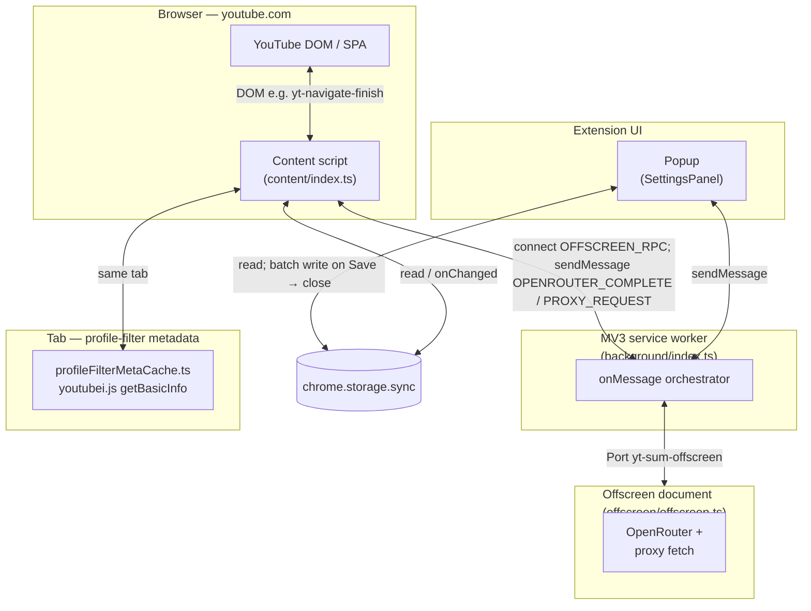
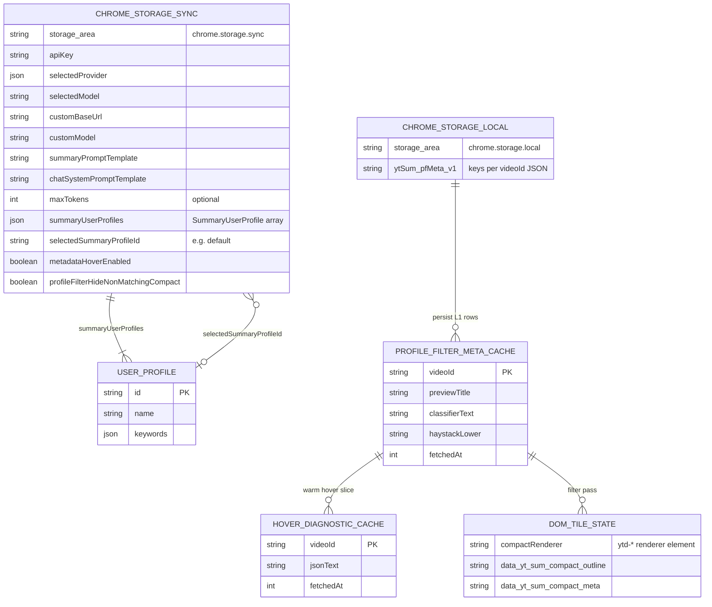
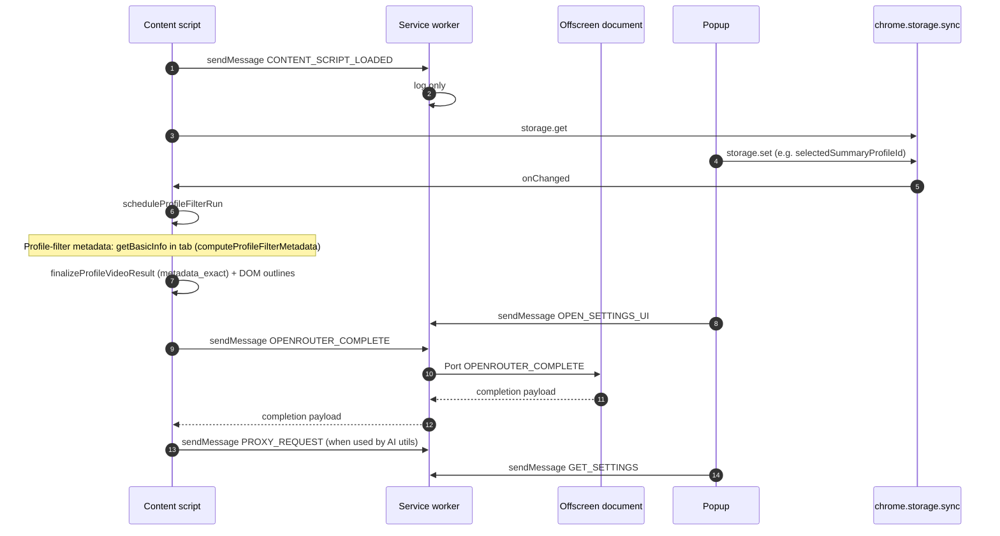
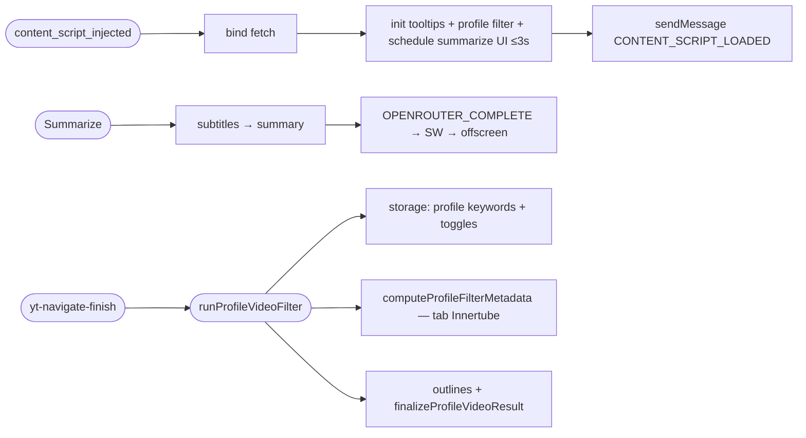

# Architecture diagrams

These diagrams summarize **[PRD.md](../PRD.md)**. **GitHub renders them automatically** on the repo page (Mermaid in Markdown).

For local preview, use a Mermaid-capable editor, or paste into [mermaid.live](https://mermaid.live).

---

## Component overview

---

## Data stores (logical ER)

Persistent settings live in **`chrome.storage.sync`**. **Profile-filter metadata** uses an in-tab `Map` (**L1**) plus **`chrome.storage.local`** (**L2**). **Hover** diagnostics cache is an in-memory `Map`. **Compact-tile** disposition is reflected on **DOM** attributes.

### Cache and retention (authoritative constants)

| Data store | Where it lives | How long data is kept | Example payload (one key / entry) |
| --- | --- | --- | --- |
| **Extension settings** | `chrome.storage.sync` | **Persistent** until changed. First **install** seeds **`summaryUserProfiles`** with **AiFocus** (`aifocus`), **News** (`news`), and **Finance** (`finance`), sets **`selectedSummaryProfileId`** to **`aifocus`**, and sets **`selectedProvider`** to **OpenRouter** with **`selectedModel`** **`xiaomi/mimo-v2.5`**. When those provider keys are unset, the UI uses the same defaults. Toolbar **Save** removes legacy **`profileFilterZeroShot*`** keys. | **Key** `selectedSummaryProfileId` → `"aifocus"` after install, or `"default"` when unset. |
| **Profile-filter metadata** | **L1:** in-tab `Map` in **`profileFilterMetaCache.ts`**. **L2:** **`chrome.storage.local`** `ytSum_pfMeta_v1::<videoId>`. | **12 minutes** per row (**`PROFILE_FILTER_META_TTL_MS`**); **~200** videos max locally. Cleared by **Clear Cache**. | JSON row with **`videoKeywordsLower`**, **`classifierText`**, etc. (**`ProfileFilterMetaHaystackPersisted`**). |
| **Metadata hover JSON** | **`videoLinkTooltips.ts`** Map | **7 days** (**`CACHE_TTL_MS`**). | `videoId` → `{ fetchedAt, jsonText }`. |
| **Transcript cache** | `youtube-transcript-plus` | **30 minutes** (**`cacheTTL`** in subtitles path). | Opaque library entry. |
| **Compact tile UI state** | DOM **`data-yt-sum-compact-*`** | **Ephemeral** per filter pass. | **`data-yt-sum-compact-meta`** may include legacy **`scores`** until tiles are re-painted after semantic classifier removal. |

**Manual reset:** **Clear Cache** clears L1 **`profileFilterMetaCache`**, all **`ytSum_pfMeta_v1::`** keys, compact tile **`data-yt-sum-compact-meta`**, and posts **`CLEAR_WORK_CACHES`** to offscreen (currently a reserved no-op).

---

## Sequence — messages and storage

---

## Event flow (condensed pseudo-code)

